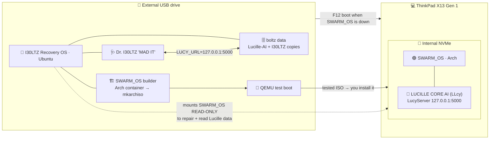

# SWARM_OS Suite: architecture

**v1.3.0 · 2026-10-01** · the source of truth for which OS is which.
If another file disagrees with this one, this one wins. Fix the other file.

## One PC, two operating systems

There's **one PC**, the Lenovo ThinkPad X13 Gen 1, and it has **two separate
operating systems**:

| | 🟣 **SWARM_OS** | 🔴 **I30LTZ Recovery OS** |
|---|---|---|
| **Base** | **Arch Linux** (built with archiso) | **Ubuntu LTS** (its own separate install) |
| **Lives on** | X13 **internal NVMe** | **External USB drive** (the Ubuntu you boot from USB today) |
| **AI assistant** | **LUCILLE CORE AI "LLcy"** | **Dr. I30LTZ "MAD IT"**, plus access to **Lucille** |
| **Job** | Daily life, gaming, coding | Repair, data recovery, and **building SWARM_OS** |
| **Repo** | SWARM_OS / Lucille repo | **this repo** (`i30ltz-recovery`) |
| **Built from** | the SWARM_OS repo (archiso) | [`os/`](../os/README.md): its own image (mkosi), v0.1.0 |

Rules:
1. **Never mix them.** SWARM_OS never gets Recovery OS packages or identity,
   and Recovery OS never gets SWARM_OS identity.
2. **Recovery OS stays on the external drive**, never on the internal NVMe. That way it
   still works when SWARM_OS, the NVMe, or the bootloader is broken.
3. **Only one OS runs at a time.** You pick one at boot: the internal drive
   means SWARM_OS, and the external USB drive means Recovery OS (press **F12**
   on the X13 for the boot menu).
4. **Recovery OS builds SWARM_OS.** The builder lives on a different drive
   from what it builds, so a bad build can never strand you. This is the
   plan from the 2026-09-18 tracker entry.

There is no third "dev workstation". **I30LTZ Recovery OS is its own OS
image** built from [`os/`](../os/README.md). It has its own name, boot menu,
splash, first-boot wizard and Dr. I30LTZ console, and it's installed onto
boltz next to the data partition. The plain Ubuntu USB in use since
2026-09-30 (set up with the `system/` kit) is the **build machine** that
makes the image. Once boltz runs the real OS, it can build its own next
versions.



## The boltz data

`/mnt/boltz` holds your Lucille-AI and I30LTZ-Recovery copies. Recovery OS
mounts it for portable Lucille (path A below). **Never format it.** If you
ever reinstall Recovery OS onto the drive that holds it, back it up first,
use manual partitioning ("Something else"), and leave that partition alone.

## Building SWARM_OS from Recovery OS

```bash
i30ltz-disks                                            # which disk is which (read-only)
swarm-build ~/SWARM_OS/30-source/swarm-os/<profile>     # Arch container → ISO
swarm-test-iso /var/lib/i30ltz/swarm-build/out/<iso>    # UEFI VM, real disks NOT attached
```
- `swarm-build` runs `mkarchiso` inside an `archlinux` container (podman).
  Builds only touch `/var/lib/i30ltz/swarm-build/` on the Recovery OS drive, and every ISO
  gets a `.sha256` file.
- `swarm-test-iso` boots the ISO in a QEMU UEFI VM with a throwaway virtual disk.
- **Installing to the NVMe is always a manual, deliberate step** using the
  SWARM_OS installer. No script in this repo writes to the internal drive.

## Lucille has to work from Recovery OS

You need Lucille most when SWARM_OS won't boot, so Recovery OS provides it in
two ways:

### A. Portable Lucille on boltz (default)
- The Lucille runtime (`lucy-server`, config and models) is read from the
  **boltz data partition**, which already holds the Lucille-AI copies, and
  served on **`127.0.0.1:5000` only**. That's the same port and API as on
  SWARM_OS, so Dr. I30LTZ uses `LUCY_URL=http://127.0.0.1:5000`.
- It works even when the NVMe is dead or locked, and it never writes to the
  drive being repaired.
- It's refreshed from SWARM_OS on purpose (a checksummed sync), never
  automatically during a repair.

### B. Your real Lucille data from the NVMe (read-only)
- Recovery OS can unlock (LUKS) and mount SWARM_OS **read-only**, so Lucille
  can read your real memory and notes. Anything it writes goes to the external drive.
- Skip this if the NVMe is failing. Image it first
  (`i30ltz-writeblock on` + `ddrescue`) and use the image instead.

### Safety rules
- Loopback only. The firewall blocks all incoming traffic, and Lucille never
  listens on the network.
- The NVMe is read-only by default. Repairs and installs are deliberate
  actions you choose, never side effects.
- No secrets in this repo. Tokens are generated per machine at first boot.

## Status (2026-10-01)

| Item | State |
|---|---|
| **I30LTZ Recovery OS image** (`os/`, mkosi, Ubuntu 24.04 base) | ✅ v0.1.0 builds; boots in a UEFI VM to the first-boot wizard and Dr. I30LTZ console |
| `install-to-drive.sh` (adds the OS beside existing partitions) | ✅ tested: data partition byte-for-byte unchanged |
| Install onto boltz + first real boot on the X13 | 🔄 next (Secure Boot off for v0.1) |
| Ubuntu USB build machine (`system/` kit v2.1.0) | ✅ 23/23 verified on the X13 |
| Secure Boot (signed shim + enrolled key) | ⏳ v0.2 |
| Dr. I30LTZ MAD IT AI + portable Lucille (A) | ⏳ v0.2: reads the boltz data partition |
| Read-only SWARM_OS mount for Lucille data (B) | ⏳ planned |
| Native Slint graphical shell (`native/`) | ⏳ later; retarget Debian 12 → Ubuntu 24.04 |
| SWARM_OS itself (archiso profile, Lucille services) | lives in the SWARM_OS repo |
