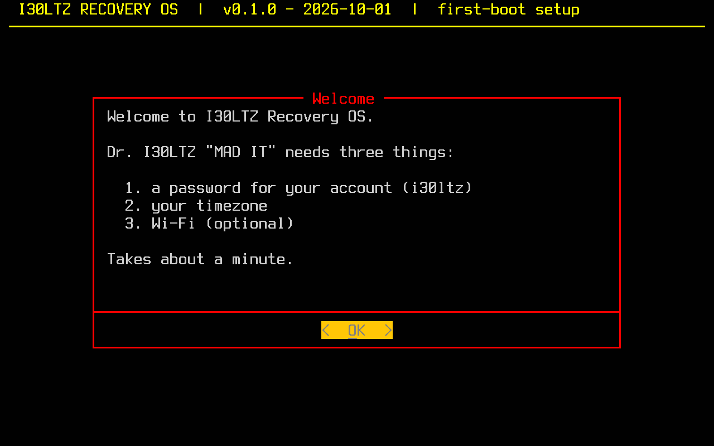
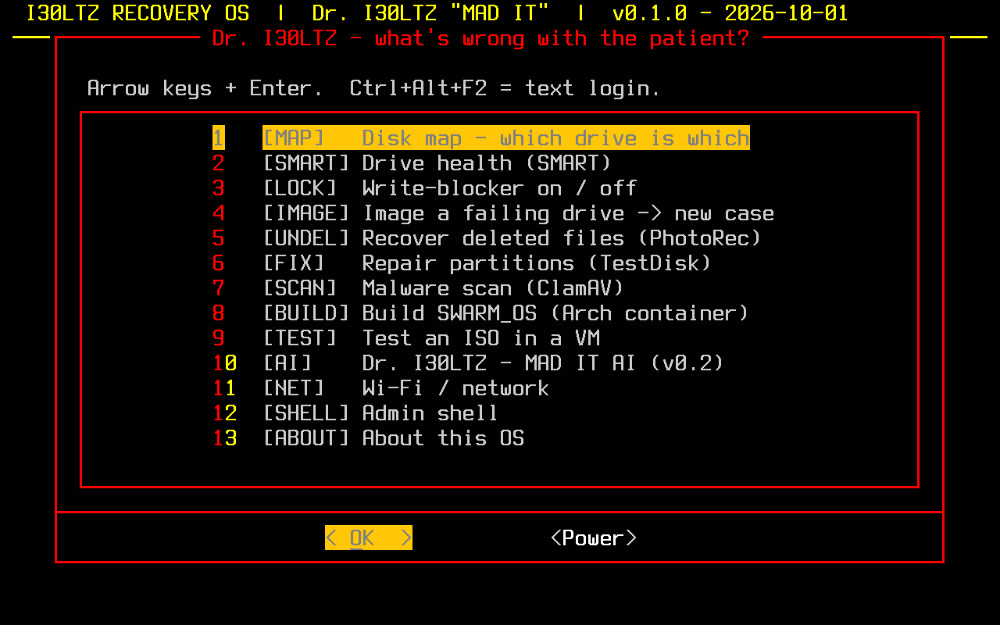

# I30LTZ Recovery OS: the operating system image

**v0.1.0 · 2026-10-01** · its own OS image, built from this folder · Ubuntu 24.04 LTS base ·
runs from an **external drive (boltz)** · boots into the **Dr. I30LTZ "MAD IT"** console

This is a real OS image, not a renamed Ubuntu install. It has its own name in
`/etc/os-release`, its own boot menu entry, boot splash, color palette,
first-boot wizard and full-screen console. Every package and setting is
defined here and rebuilt identically each time.

| First boot (sets your password) | Dr. I30LTZ console (home screen) |
|---|---|
|  |  |

*Real screenshots of v0.1.0 booting in a UEFI virtual machine, 2026-10-01.*

## Three commands

Run these on the Ubuntu you're using now, which becomes the build machine:

```bash
cd ~/SWARM_OS/30-source/i30ltz-recovery/os
sudo bash build.sh                                                  # 1. build  (~5 min, ~15G free)
sudo bash test-vm.sh out/v0.1.0_<date>                              # 2. try it in a window
sudo bash install-to-drive.sh out/v0.1.0_<date> /dev/sdX --dry-run  # 3. preview install to boltz
sudo bash install-to-drive.sh out/v0.1.0_<date> /dev/sdX            #    then install for real
```

Then plug boltz into the X13, power on, press **F12**, and pick the USB drive.

## Installing onto boltz keeps your data

`install-to-drive.sh` only **adds two partitions in free space**: a 1G boot
partition and the OS. It never writes to, moves or resizes existing
partitions, so the boltz data partition (Lucille-AI / I30LTZ copies) stays
exactly as it is. It refuses to run when the target:

- is the internal NVMe or isn't USB-attached (that's where SWARM_OS lives),
- holds the running system or has anything mounted (`sudo umount /mnt/boltz` first),
- is MBR-partitioned with partitions on it,
- already has an OS root partition,
- has less than about 13G of free space.

You also have to type the disk's name to confirm. It was tested on a 40G
test drive holding a 10G data partition with files on it: after
installing, the data partition was **byte-for-byte identical**, and the OS
booted to the first-boot wizard.

> If boltz has no free space: back up the data partition, shrink it with
> GParted to free ~30G, then run the installer.

## What's inside

| Area | Contents |
|---|---|
| Boot | systemd-boot menu "I30LTZ Recovery OS 0.1.0 (date)", unified kernel image, red/yellow boot splash, `editor no` (boot options can't be edited at the menu) |
| Home screen | Dr. I30LTZ console on the text console (works even without GPU drivers), I30LTZ palette, big Terminus font. Ctrl+Alt+F2 opens an emergency text login |
| First boot | Choose your password (no password ships in the image), timezone, Wi-Fi |
| Security | Firewall on (blocks all incoming), AppArmor, kernel hardening, no core dumps, SSH masked, automatic security updates, root locked |
| MAD IT tools | SMART/NVMe health, write-blocker, ddrescue imaging into private cases, PhotoRec, TestDisk, ClamAV, sleuthkit, LUKS/LVM/RAID tools |
| SWARM_OS builder | podman + `swarm-build` (Arch container → ISO), QEMU + OVMF + `swarm-test-iso` |
| Performance | zram (zstd), weekly TRIM, Intel/AMD video decode |

## Folder layout

```
os/
├── README.md               this page
├── build.sh                build: pinned mkosi v26 → out/v<version>_<date>/ + SHA256SUMS
├── test-vm.sh              boot a build in a UEFI VM (works on a copy)
├── install-to-drive.sh     put a build onto boltz without touching other partitions
├── mkosi.conf              the recipe: base, packages, boot, build sandbox
├── mkosi.version           0.1.0  (bump for each release)
├── mkosi.repart/           partition layout: ESP 1G + root
├── mkosi.postinst.chroot   branding, account, case store, services (build time)
├── mkosi.extra/            files baked into the OS
│   ├── etc/…               kiosk + first-boot units, presets, hardening, palette, theme
│   ├── efi/loader/         boot menu settings
│   ├── opt/i30ltz/bin/     i30ltz-console, i30ltz-firstboot, i30ltz-disks,
│   │                       i30ltz-writeblock, swarm-build, swarm-test-iso
│   └── usr/share/plymouth/ boot splash
└── docs/screenshots/       dated screenshots of each release
```

The helpers in `mkosi.extra/opt/i30ltz/bin/` are the single copy: the
`system/` first-boot kit installs the same files.

## Known limits of v0.1.0 (honest list)

- **Secure Boot must be OFF** in the X13 firmware to boot it. The image
  isn't signed yet. v0.2 plans a signed shim plus your own enrolled key (MOK).
- **Dr. I30LTZ AI (MAD IT) and portable Lucille aren't in yet.** The menu
  item says "v0.2".
- Only tested in a virtual machine so far. The first real-hardware boot is
  on the X13 via boltz.
- The image is about 3G used, mostly kernel firmware. It will be trimmed later.
- The boot splash shows after the kernel starts, not from the first second.
